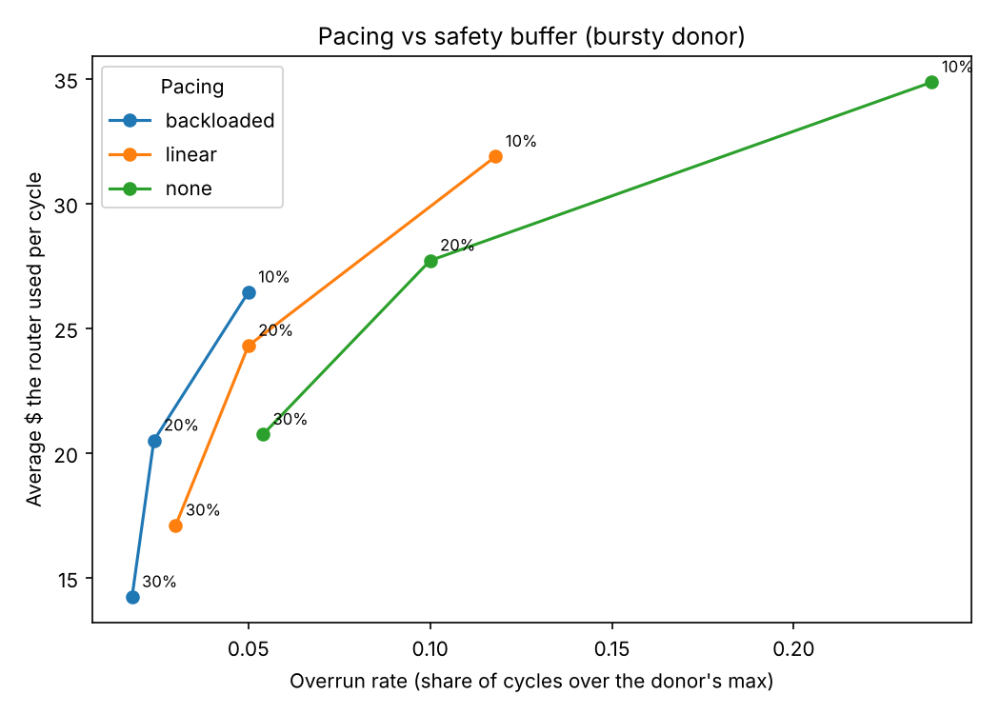
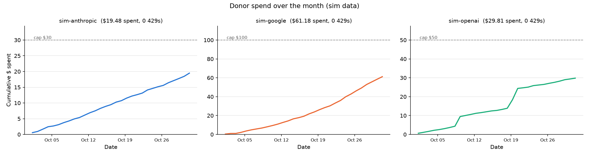
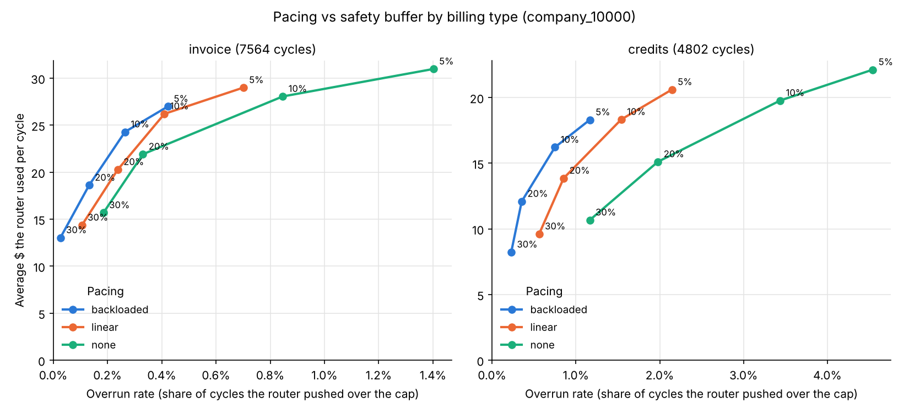
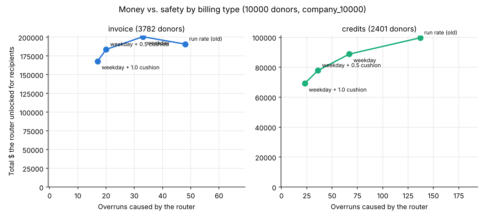

# Forecast Engine by Aydan Gonzalez

## What this does
Figures out how to route AI tokens from API keys that have budget to spare to the people who need them, without pushing any key's owner past their own limit. For each key it forecasts how much the owner will spend themselves, works out the leftover, and decides how much can be routed each day and when to stop.

## Files
- `policy/donor_policy.py` - donor rules (`DonorPolicy`), how many dollars the router can still spend (`allowed_usage`), and whether a task fits on an API key (`can_route`)
- `policy/key_validator.py` - checks an API key's format for the following companies currently: Anthropic, OpenAI, Google, Microsoft
- `pacing/pacing_sim.py` - simulates a month of donor spending (steady, bursty, ramp-up) and
  compares pacing strategies
- `pacing/buffer_sweep.py` - reruns the simulation with 10%, 20%, and 30% safety buffers and plots
  the trade-off
- `real_calls/log_real_calls.py` - makes a few small real API calls per test key (Anthropic, OpenAI, Google) and logs tokens, cost, latency, and status to the local database
- `october_sim/simulate_month.py` - simulates a full month (October) of donor usage for 3 donor types and writes it to the same table, tagged as `sim`
- `october_sim/plot_usage.py` - charts each donor's spend over the month against their cap
- `heartbeat/company_sim.py` - simulates N donors over two months (Oct + Nov) with 6 profiles (enterprise, startup, research lab, agency, individual, agent), 3 billing types and random spike events, and saves their daily spend to `token_router.donor_daily`
- `heartbeat/heart_beat.py` - replays each donor day by day, following its own billing cycle: what the router can unlock for recipients, how much limit is left and how reliable the donor is. Saves `data/heartbeat_<run>.csv`
- `heartbeat/compare_forecasts.py` - compares the 4 forecast methods (run rate, weekday, weekday + 0.5 / 1.0 cushion): money unlocked vs overruns caused, one panel per billing type
- `heartbeat/buffer_sweep.py` - tries every pacing (none, linear, backloaded) with 5%, 10%, 20% and 30% buffers on the simulated donors, one panel per billing type
- `heartbeat/plot_heartbeat.py` - chart for one donor: its own daily spend (heartbeat) on top, what the router unlocks below, with billing resets and spike events marked
- `heartbeat/compare_donor.py` - one donor, each forecast method's daily unlock as lines
- `real_calls/sql/001_key_usage.sql` - creates the `token_router.key_usage` table
- `tests/` - pytest tests for the policy and key validator
- `data/` - heartbeat CSVs (the router reads these)
- `figures/` - charts from the simulations

Run everything from inside `forecast-engine/` with `python -m <folder>.<file>`, for example:
```
python -m heartbeat.company_sim 1000
python -m heartbeat.heart_beat company_1000
python -m heartbeat.compare_forecasts company_1000
python -m heartbeat.buffer_sweep company_1000
python -m heartbeat.plot_heartbeat donor-0000 company_1000
```
A local Postgres database has to be running first, with its URL in `LOCAL_DB_URL` in a `.env` file. Runs with 10,000 donors work the same way (`company_10000`), but their CSVs are big and are git-ignored.
Tests: `pytest` (also from `forecast-engine/`).

## Donor Policies
- **Fixed cap:** donor allows a set budget per month like 20 dollars. The router stops when it has spent all of it.
- **Excess capacity:** The router uses the donor's leftover capacity without pushing them past their own max before the billing cycle resets.
- **Pacing** controls how fast the allowance opens up for excess-capacity donors
    - none: All at once
    - linear: Evenly across the month
    - backloaded: Slow early, fast late
- **Safety buffer** keeps a share of the donor's max untouched (default 10%)
- **First 3 days:** The router takes nothing until there's enough data to forecast the
donor's spending

All amounts are in dollars per billing cycle, per key.

## Billing types
Chat subscriptions (ChatGPT Plus, Claude Pro, etc.) are out of scope since they don't give an API key that can be shared. The router targets these three, based on my billing research across OpenAI, Anthropic, Google, xAI and Amazon:

| | Invoice | Credits | Prepaid |
|---|---|---|---|
| How it works | Use the API, billed at month end, with a spend limit | Plan includes monthly API credits (e.g. Claude Max / Team) | Load money upfront (default for new OpenAI, Gemini, xAI, Anthropic accounts) |
| Resets | On the billing day | On the billing day | Never (only on top-up) |
| Leftover | Not charged | Expires | Stays in the balance |
| Rule | `excess_capacity`, 10% buffer, backloaded | `excess_capacity`, 10% buffer, backloaded, last day unlocks fully | Keep 60 days of the donor's own spend + 10% of the balance in reserve |

Every type uses the **weekday forecast + 0.5 cushion**: the donor's average spend per weekday predicts the rest of the cycle, plus half of their biggest day so far. Before a donor's first reset, the router stays out, since it can't see what was already spent that cycle.

**Buffer vs cushion:** the buffer lowers the cap (10% of a $100 cap means the router treats $90 as the limit). The cushion raises the forecast based on how spiky that donor is. The leftover is the gap between the two, and pacing decides how much of it is open yet.

## Donor profiles (company_sim)
Budgets come from public spending data (Ramp, Anthropic Claude Code docs, startup and agency surveys) and the billing mix from my billing research.

| Profile | Share | Median monthly budget | Invoice / credits / prepaid | Pattern |
|---|---|---|---|---|
| enterprise | 25% | $10,000 | 75 / 15 / 10 | weekdays, month-end crunch |
| startup | 22% | $1,000 | 25 / 25 / 50 | big Fridays, growing through the month |
| research_lab | 13% | $300 | 40 / 20 / 40 | bursty Fridays, some weekend work |
| agency | 10% | $800 | 30 / 30 / 40 | weekdays only, big month-end crunch |
| individual | 20% | $60 | 5 / 40 / 55 | evenings and weekends, skips ~45% of days |
| agent | 10% | $1,500 | 45 / 5 / 50 | flat 24/7, rare runaway loops |

Each donor's budget is drawn around the median with a per-profile `standard_deviation` (of the log of the budget) and clipped to `cap_min` / `cap_max`. Random spike events sit on top of normal spend: hackathon weekends (3 to 6x), viral days (5 to 15x, fading over 3 days) and runaway agent loops (8 to 15x for a day).

## How routing uses it
    can_route(policy, key_state, estimated_cost)

## Results so far (excess-capacity donors)
- **Steady donors:** no overruns with any pacing, so no pacing is fine
- **Ramp-up donors:** no pacing overruns often; linear or backloaded keeps it at 0%
- **Bursty donors:** backloaded pacing gets the router the most money at a ~5% overrun rate
  ($26.44 per cycle vs $24.30 for linear and $20.74 for none at similar risk)



*Each line is a pacing strategy, and each dot is a buffer size (10%, 20%, 30%). Up and to the left is better: more money for the router, fewer overruns*

## Real and simulated usage
- **Real calls:** all 3 test keys work and log correct costs (about $0.00001 to $0.0001 per small call). Microsoft/Azure is waiting on a model deployment
- **Simulated October:** 3 donors with different patterns and caps
    - Anthropic (steady, $30 cap): $19.48 spent
    - OpenAI (bursty, $50 cap): $29.81 spent, with big jumps around Oct 9 and Oct 19
    - Google (ramp-up, $100 cap): $61.18 spent, slow early and steeper late



*The gap between each line and its dashed cap is the leftover capacity the router could route recipients to*

## Results: heartbeat on 10,000 donors (Oct + Nov)
With the settings above (backloaded, 10% buffer, weekday + 0.5 cushion, 60-day prepaid runway):

| Billing | Billing cycles | Unlocked by the router | Overruns caused by the router |
|---|---|---|---|
| invoice | 7,564 | $183,686 | 20 (0.26%) |
| credits | 4,802 | $77,861 | 36 (0.75%) |
| prepaid | 3,817 | $115,003 | 132 (3.46%) |

- **Backloaded beats linear at the same buffer.** At 10%, invoice overruns go from 0.26% (backloaded) to 0.41% (linear) and credits from 0.75% to 1.54%. A 1,000-donor run made linear look free for invoice; the 10,000 run shows that was noise.
- **The weekday forecast cuts overruns a lot compared to the old run rate**, mostly by seeing big Fridays coming.
- **Prepaid is the risky type.** A spike drains a balance that never resets, so even a 60-day runway leaves ~3.5% of donors running out because of the router.



*Each line is a pacing, each dot a buffer size. Up and to the left is better.*



## Progress
- Oct 19–23: key validator (4 providers), donor policy v1, local database set up, fixed a usage loading bug in the data pipeline
- Oct 25: pacing sim (3 patterns)
- Oct 26: first-3-days forecast rule, buffer sweep, bursty trade-off chart
- Oct 29: 3-panel trade-off chart for all patterns
- Oct 30-Nov 4: real API calls logged to the local database for Anthropic, OpenAI, and Google keys. Also simulated a month of donor usage, usage chart, started the heartbeat
- Nov 5-16: company-like donor sim, heartbeat with a reliability score per key, weekday forecast + cushion, reorganized forecast-engine into folders
- Nov 20: billing research across OpenAI, Anthropic, Google, xAI and Amazon; chat subscriptions ruled out
- Nov 21-24: two-month sim with 3 billing types, individual and agent profiles, spike events, billing-cycle-aware heartbeat, prepaid runway rule, buffer sweep by billing type, real-world donor budgets, 10,000-donor runs


## Next Steps
- Model prepaid top-ups, and let a spike stop counting against a donor after ~30 days
- Tune the reliability function (currently 0.4 x size + 0.6 x weekly consistency, size = given / (given + 7.5))
- Collect real test keys from friends / CalHacks (low spend limits)
- Convert dollars to tokens per model using pricing data (needed for the router)
- Set up the Azure deployment so Microsoft keys can be tested
- "Best option per pattern" chart once the overrun limit (5% or 2%) is decided
- Smarter forecast so ramp-up donors don't fool it
- Spread usage fairly across multiple donors, so routing doesn't always favor one large donor
- Apply the engine to other shared-budget problems, such as managing AI tokens for colleges: splitting a university's API credits across students, classes and research groups so they get used without anyone running out mid-semester